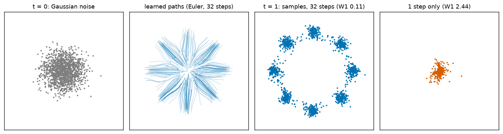
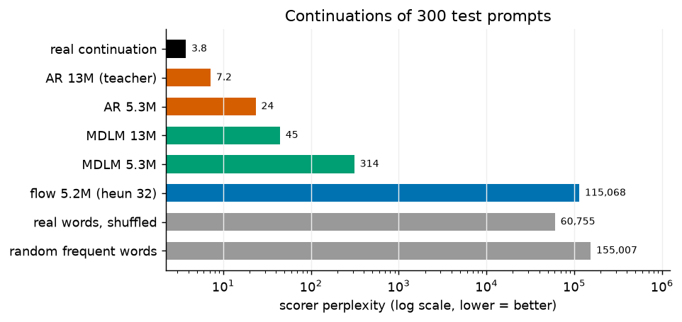
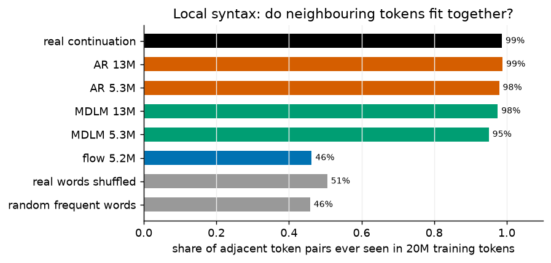
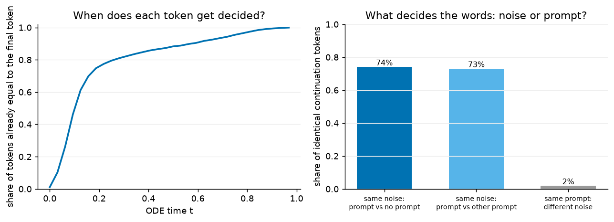
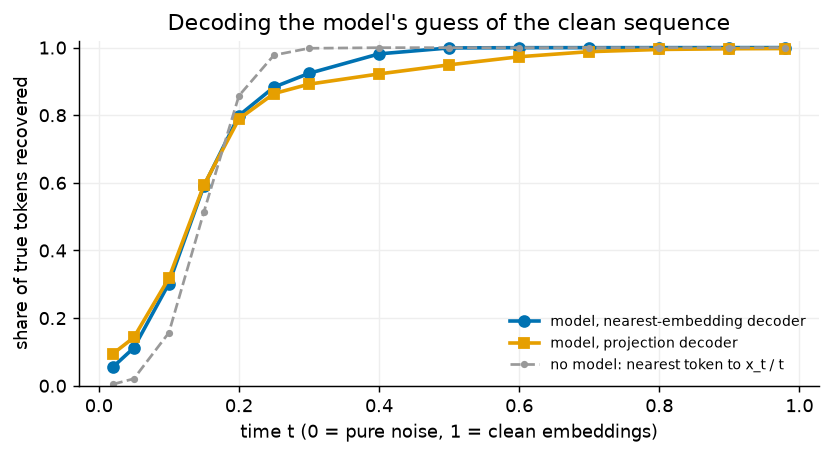
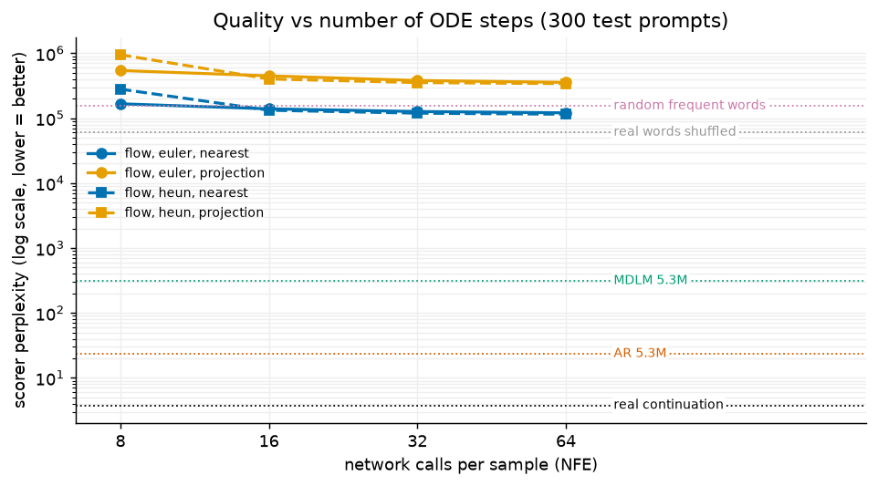
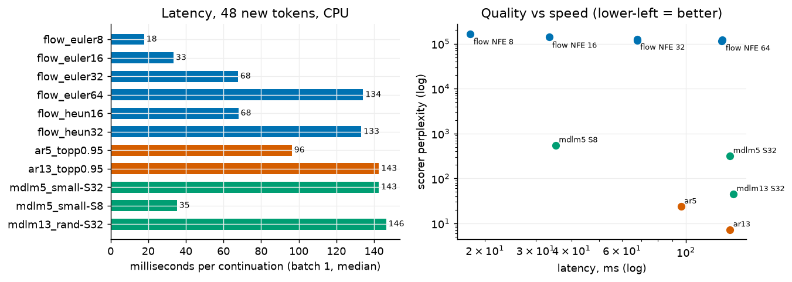
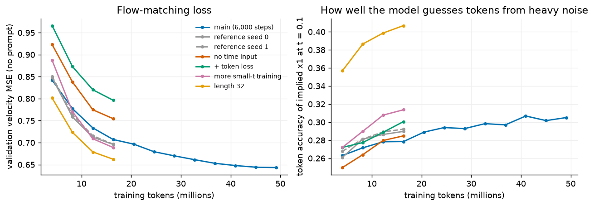
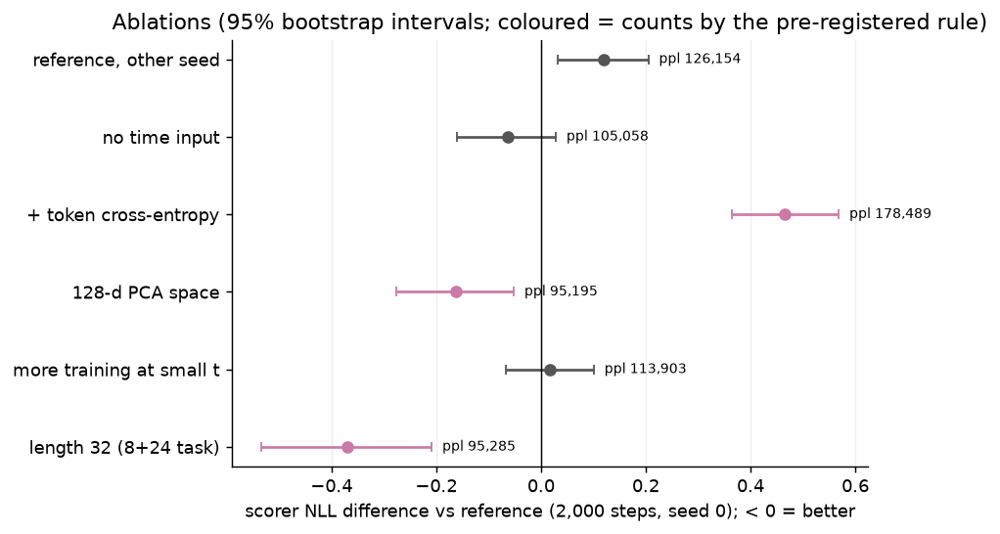

# Flow-Matching Language Model

Project 10 of a series on small language models. This project builds a language model that writes all 64 positions
of a text **at once, in a continuous space**. Every token is a point (its frozen embedding). A Transformer learns a
**velocity field** that moves Gaussian noise along straight lines to sequences of token embeddings (**flow
matching**). An ODE solver (Euler or Heun) follows the field, and each end point is rounded to the nearest token. The
model is compared with autoregressive (AR) and masked-diffusion (MDLM) models of the same size and training budget.
Everything runs on a CPU.

**Research question:** can a small continuous flow-matching model write coherent text, and where does the
continuous-to-discrete step succeed or fail compared with AR and diffusion LMs?

**Setup:**
* **Data:** the first 64 tokens of 1.77M TinyStories, with the Project 1 tokenizer.
* **Frozen embeddings:** 384-d Project 1 embeddings, standardised.
* **Model:** a bidirectional Transformer with adaLN time conditioning, **5.18M parameters**, trained on **49M
  tokens**. That is the same size and budget as AR-5.3M (Project 2) and MDLM-5.3M (Project 3).
* **Test:** the first 16 tokens of 300 held-out openings are the prompt. Each system writes 48 new tokens, and an
  independent model (TinyStories-33M) scores them.

**How it works, on a toy problem first:** noise (left) follows the learned velocity along nearly straight paths
and lands on 8 data blobs after 32 Euler steps. With a single step every point lands on the *average* of the blobs,
the empty centre. The same averaging comes back with text.



**Short answer: no. At this size and budget, the flow LM writes word salad, though it writes it fast.**
* **Text quality:** scorer perplexity is **117,771**, against **313** for MDLM-5.3M and **22.7** for AR-5.3M. A
  blind AI review gave all 20 flow samples coherence 0/2. AR-5.3M got 1.05 and MDLM-5.3M got 1.00.
* **Word choice:** the flow text sits between *shuffled real words* (60,756) and *random frequent words* (155,007).
  It picks words that fit stories and partly fit the prompt, but puts them in no order. Only 46% of its adjacent token
  pairs ever occur in training text, the same rate as random words (46%). Real text scores 99%.
* **Where it fails:** about 75% of tokens are decided by t = 0.2. At that point the model can only guess 30–80% of
  tokens, and each position decides almost on its own. As a result, **the starting noise decides the words, not the
  prompt**: with the same noise, 74% of tokens are identical with or without the prompt.
* **Rounding is not the problem:** tokens are 19 units apart, and even noise as large as the data rarely changes
  the nearest token. Instead, generated vectors end **between** tokens, at distance 13.5. The MSE-trained velocity
  averages over plausible sentences and loses which word goes next to which.
* **More training doesn't help:** training 3× longer lowers the flow loss (0.696 → 0.643) but **not** the text
  quality.
* **Speed:** 32 Euler steps take 68 ms per continuation. That beats AR-5.3M (96 ms, KV cache) and MDLM-5.3M (143 ms).



## Results (300 test prompts, 16-token prompt + 48 new tokens)

| System | Parameters | Scorer perplexity | Blind coherence (0–2) | Blind relevance (0–2) | Latency (batch 1) |
|---|---|---|---|---|---|
| real continuation | — | 4.0 | 2.00 | 2.00 | — |
| AR-13.9M | 13.9M | 7.2 | — | — | 143 ms |
| **AR-5.3M** | 5.3M | **22.7** | 1.05 | 1.70 | 96 ms |
| MDLM-13.9M (32 steps) | 13.9M | 44.6 | — | — | 146 ms |
| **MDLM-5.3M** (32 steps) | 5.3M | **313** | 1.00 | 1.20 | 143 ms |
| **flow 5.2M** (Heun 32 steps = 64 calls) | 5.2M | **117,771** | **0.00** | **0.45** | 133 ms |
| flow 5.2M (Euler 8 steps) | 5.2M | 166,705 | — | — | 18 ms |
| real words, shuffled | — | 60,756 | — | — | — |
| random frequent words | — | 155,007 | — | — | — |

Flow and the 5.3M baselines use 3 seeds. Paired NLL differences: flow − MDLM-5.3M is **+5.93** [+5.86, +6.00]
nats/token. Flow − random words is −0.28 [−0.37, −0.18].

**Example** (same prompt for every system; prompt in italics):

> *Lily and Tom are playing in the park. They see a big pile of waste*
> * **real:** near the bin. It is dirty and smelly. Lily and Tom do not like it. "Who put this waste here?" Lily asks.
> * **AR-5.3M:** . They ask Mom and Dad if they don't have enough for dinner. Mom and Dad are not sad. …
> * **MDLM-5.3M:** . The leaves and the sun was with a leaves sticks. The fish were blue fish and laughed and laughed, …
> * **flow:** . yellow. different things It round Mae Nick the Phil mom dinosaur to. of not lo blinking swam the …

## Why it fails: words without order

Real text and both baselines almost always put tokens next to each other in pairs that occur in real stories. The
flow model does this only as often as random words do:



**The noise decides, and it decides early.** Left: along the sampling path, most tokens are already fixed within the
first fifth of the time. Right: with the same starting noise, 74% of the generated tokens stay the same whether the
real prompt, no prompt or another prompt is given; with new noise only 2% stay the same.



**What the model knows at each moment.** If a real text is hidden behind the noise, the model's guess of it decodes
to the right token 30% of the time at t = 0.1 and 80% at t = 0.2. Between t = 0.2 and 0.4 the guess is even worse than
simply rescaling the noisy input. So tokens get fixed while the model is still unsure which sentence it is writing.



## Steps, solvers and speed

More ODE steps help slowly. Every flow setting stays far above MDLM and AR, and between shuffled real words and random
words:



Speed is not the problem. A flow step costs 2.1 ms and an MDLM step 4.5 ms, because the flow model outputs 384 numbers
per position instead of scores for 8,192 words:



## Training and ablations

The flow loss keeps falling for the whole run (left). The 2,000-step references write text that is just as good as
the 6,000-step main model, so a lower loss did not buy better text.



Each ablation changes one ingredient and trains for 2,000 steps. Pink means it counts by the pre-registered rule: its
interval excludes 0 and it lies outside the two reference seeds.



## What the experiments showed

| Question | Finding |
|---|---|
| ODE steps | 8 → 32 → 64 Euler steps: 167k → 127k → 121k. Latency grows linearly (2.1 ms per network call). |
| Euler vs Heun | At equal network calls, Heun is better from 16 calls up and much worse at 8. |
| Decoder | Nearest embedding beats the projection head by 3×. Projection produces 24% unknown words. |
| Decision time | 61% of final tokens are fixed by t = 0.12, and 80% by t = 0.25. |
| Prompt use | The prompt is kept exactly in 100% of samples. Only 46% of continuations re-use the prompt's name (AR 78%, real 95%). |
| No time input | Validation MSE is higher, but the text is not measurably different. |
| + token cross-entropy | The only harmful change (+0.47 nats), and it makes positions commit even earlier. |
| 128-d PCA space | Slightly better (95k vs 112k). |
| 32-token windows | Better on the 8+24 task (95k vs 138k). |
| More training at small t (t = u²) | No effect. |

All ablation effects (≤ 0.47 nats) are tiny compared with the gap to MDLM (≈ 6 nats). Every variant still writes word
salad. Of 12 pre-registered hypotheses, 4 held (one of them only mostly), 2 held partly, and 6 were refuted
or not supported. The refuted ones include "flow is slower than AR" and "the token loss helps most". Details are in [INSTRUCTIONS.md](INSTRUCTIONS.md), Phase 16.

## Reproduce
```
python -m venv .venv && .venv\Scripts\activate && pip install -r requirements.lock.txt
python scripts/env_report.py && python -m flow.toy2d
python -m flow.dataset && python -m flow.embeddings
bash scripts/lr_pilot.sh && bash scripts/train_all.sh                 # about 3 hours on 24 CPU threads
python -m flow.run_eval --stage dev && python -m flow.run_eval --stage test && python -m flow.run_eval --stage ablations
python -m flow.compare && python -m flow.diagnose && python -m flow.benchmark
python -m flow.errors --stage auto && python -m flow.plots && pytest
```
This needs the sibling folders `project1` (tokenizer, token data, `small` checkpoint), `project2` and `project3`
(baseline checkpoints), and `project4` (`bench/`, scorer download), all opened read-only. File hashes are in
`results/metrics/env.json`. Data and checkpoints are not in the repository. Metrics, every generation, the review
files and the figures are.

**Files:** `flow/` (code), `configs/` (settings and pre-registered hypotheses), `scripts/`, `tests/` (15 tests),
`results/` (metrics, generations, figures), [INSTRUCTIONS.md](INSTRUCTIONS.md) (all 16 phases with numbers), and
`project10.html` (illustrated tutorial).

**Limitations:** one model size, one 49M-token budget and a fixed 64-token window. Ablations use one seed. The blind
review was done by an AI annotator (Claude), not by people. The scorer measures fluency, not story quality.

Data: TinyStories (CDLA-Sharing-1.0). Scorer: TinyStories-33M (MIT).
